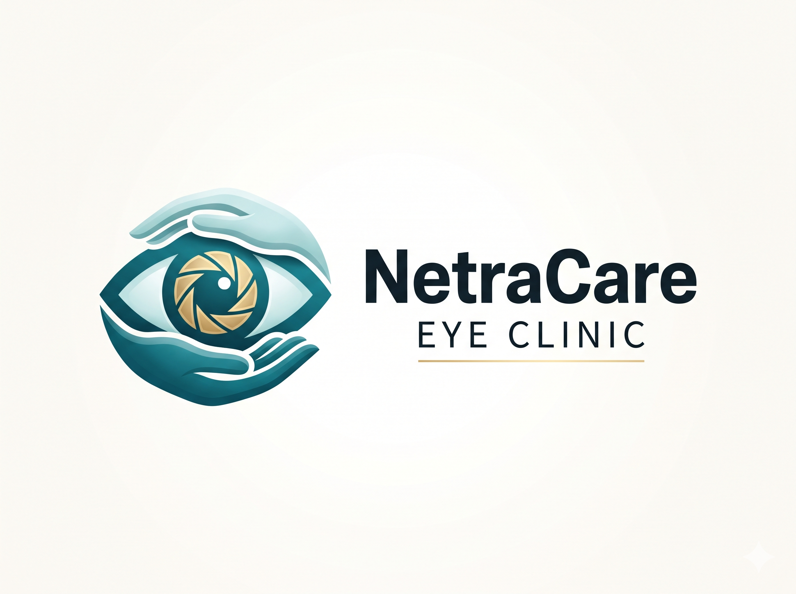

# 🏥 NetraCare — AI Front Desk & Care Coordination System

> *Intelligent. Safe. Human-first.*  
> An AI-powered ophthalmic clinic management platform built for real-world clinical workflows.

---

## 📸 Brand Identity

| Asset | Description |
|---|---|
|  | Full brand lockup — horizontal layout |
|  | Circular emblem — used for favicon & badge |

---

## 🎯 Project Overview

**NetraCare** is a full-stack, production-grade AI clinical front desk and care coordination platform designed for a 5-doctor ophthalmic (eye) clinic. It combines deterministic safety rules, LLM-powered intelligence, a RAG knowledge base, a conversational LangGraph agent, and a live visit management system — all wrapped in a polished React web portal.

### Key Stats at a Glance

| Metric | Value |
|---|---|
| 👨‍⚕️ Doctors | 5 specialists across 6 sub-specialities |
| 📅 Booking Window | 30 days |
| 🧪 Automated Tests | 87 passing (100%) |
| 🛡️ Safety Rules | 16 hard booking rules + red-flag triage |
| 🧠 AI Engine | Google Gemini 2.5 Flash via LangChain |
| 📚 Knowledge Base | 38+ sections (hybrid BM25 + vector retrieval) |
| 🔌 MCP Servers | 2 (NetraCare MCP + CityCare Lab MCP) |
| 🤖 Agent Skills | 5 clinical skill packages |
| 🏗️ Iterations | 7 complete |

---

## 🛠️ Technology Stack

### Backend

| Component | Technology |
|---|---|
| Language | Python 3.14 |
| Web Framework | FastAPI (async REST API) |
| ORM | SQLAlchemy 2.0 |
| Database | SQLite (dev/test) · PostgreSQL (prod) |
| Migrations | Alembic (auto-seed on startup) |
| Validation | Pydantic v2 |

### AI / LLM Layer

| Component | Technology |
|---|---|
| LLM | Google Gemini 2.5 Flash |
| LLM SDK | LangChain Google GenAI (`langchain_google_genai`) |
| Agent Orchestration | LangGraph (`StateGraph`, `ToolNode`, `InMemorySaver`) |
| Conversation Memory | LangGraph `InMemorySaver` (per `thread_id`) |
| RAG Engine | ChromaDB (vector store) + Rank-BM25 (keyword) |
| Retrieval Strategy | 50/50 Hybrid Rank Fusion (Top-4 chunks) |
| Query Rewriting | Contextual 6-message history rewriter |
| Observability | Opik (tracing, evaluation, cost tracking) |

### Frontend

| Component | Technology |
|---|---|
| Framework | React 18 |
| Build Tool | Vite 5.4 |
| Icons | Lucide React |
| Fonts | Outfit · Reenie Beanie · IBM Plex Mono |
| Theme | CSS variables — softly pastel-inspired |
| State Management | React Context API |

### Design System (Colour Palette)

| Token | Value | Usage |
|---|---|---|
| `--bg-cream` | `#FDFCF8` | Page background |
| `--coral` | `#FFB7B2` | Accents, badges, highlights |
| `--charcoal` | `#292524` | Primary text |
| `--glass` | `rgba(255,255,255,0.72)` | Navbar, cards |
| `--noise` | CSS overlay | Parchment texture |

### Integrations & Infrastructure

| Component | Technology |
|---|---|
| MCP Protocol | FastMCP (Streamable HTTP) |
| Partner Lab MCP | CityCare Lab MCP server (port 8002) |
| NetraCare MCP | External booking server (port 8001) |
| Testing | pytest + FastAPI TestClient |
| Deployment | Render (auto-deploy from `main`) |
| Observability | Opik cloud dashboard |

---

## 🏛️ System Architecture

```
┌────────────────────────────────────────────────────────────────────┐
│                        Interaction Channels                        │
│                                                                    │
│   React Web Portal (port 5173)        External Partners           │
│   ├── Patient Portal                  └── NetraCare MCP :8001     │
│   ├── Doctor Dashboard                                             │
│   ├── Staff Desk                      CityCare Lab MCP :8002       │
│   ├── Full-Page Chat (/chat)          └── Lab Test Info Tool       │
│   └── Floating Chat Widget (all pages)                             │
└───────────────────────────────┬────────────────────────────────────┘
                                │  REST API
                                ▼
┌────────────────────────────────────────────────────────────────────┐
│               Deterministic Safety Pre-Filter                      │
│         red_flags.check_red_flags() → 100% coverage               │
│         5 emergency categories · negation-aware regex              │
│         → Emergency Script + UrgentCase(source=...) in DB         │
└───────────────────────────────┬────────────────────────────────────┘
                                │
                    ┌───────────┴───────────┐
                    ▼                       ▼
   ┌─────────────────────────┐  ┌──────────────────────────────────┐
   │   LangGraph Agent       │  │   Hybrid RAG Knowledge Base      │
   │   (Booking Requests)    │  │   (Clinical Q&A)                 │
   │                         │  │                                  │
   │  StateGraph             │  │  38+ document sections           │
   │  ├── intent_classify    │  │  BM25 keyword search             │
   │  ├── red_flag_check     │  │  ChromaDB vector search          │
   │  ├── find_slots         │  │  50/50 hybrid rank fusion        │
   │  ├── book_appointment   │  │  History query rewriter          │
   │  ├── get_skills         │  │  Source citation formatter       │
   │  ├── lab_info           │  │  Zero-diagnosis guard            │
   │  └── HITL confirm       │  │  "I don't know" fallback         │
   │                         │  └──────────────────────────────────┘
   │  InMemorySaver          │
   │  (thread_id sessions)   │
   └───────────┬─────────────┘
               │
               ▼
┌────────────────────────────────────────────────────────────────────┐
│               Single Rule Engine (BookingService)                  │
│                                                                    │
│  ✔ 10-minute slot alignment         ✔ Surgery session blocks      │
│  ✔ 30-day booking window            ✔ Speciality matching         │
│  ✔ 20m new / 10m follow-up          ✔ 1 active per speciality     │
│  ✔ Sunday & holiday closure         ✔ Follow-up doctor continuity │
│  ✔ OPD vs Surgery vs Off days       ✔ Zero double-booking         │
│  ✔ 2-hour cancellation cutoff       ✔ Paediatric <16 gate         │
│  ✔ Mandatory visit reason           ✔ HITL re-routing on leave    │
└───────────────────────────────┬────────────────────────────────────┘
                                │
                                ▼
┌────────────────────────────────────────────────────────────────────┐
│                        Database Layer                              │
│         SQLite (dev/test)  ·  PostgreSQL (production)             │
│         SQLAlchemy 2.0 ORM · Auto-seed on startup                 │
│                                                                    │
│  Tables: patients · doctors · appointments · weekly_schedules     │
│          holidays · doctor_leaves · urgent_cases · approvals      │
└────────────────────────────────────────────────────────────────────┘
```

---

## 🗺️ Iteration Roadmap

```
Iteration 1 ──► Iteration 2 ──► Iteration 3 ──► Iteration 4 ──► Iteration 5 ──► Iteration 6 ──► Iteration 7
   Core            LLM             RAG          LangGraph         Evals            MCP           Full AI
  Engine          Safety          Chat           Agent           & Opik           Skills        Platform
```

### Iteration 1 — Core Engine
- Full clinic data model: `Patient`, `Doctor`, `Appointment`, `WeeklySchedule`, `Holiday`
- Auto-seed loader (5 doctors, schedules, 10 patients, 10 initial appointments)
- Single Rule Engine (`BookingService`) — 16 hard booking rules
- Role-based React portals: Patient, Doctor, Staff
- 38 automated rule tests (100% pass)

### Iteration 2 — LLM Safety Layer
- 🔮 **Fact of the Day** with daily refresh and mandatory clinical caveat
- 🚨 **Red-Flag Emergency Triage** — deterministic regex across 5 categories, negation-aware
- 📊 **UrgentCase** dashboard for Staff (source: BOOKING | CHAT | MCP)
- 📝 **AI Clinical Summary** — `<120 words`, zero unsolicited diagnosis/advice, doctor-attributed
- 📋 Mandatory visit reasons (up to 300 chars) and mandatory doctor notes on visit completion
- ✅ 9 new automated tests

### Iteration 3 — RAG Knowledge Base
- 📚 Hybrid BM25 + ChromaDB vector retrieval (38+ sections from clinic docs)
- 💬 Patient Chat with accurate policy/procedure answers + formatted source citations
- 🔄 Contextual 6-message history query rewriter
- 🔍 Staff Search Debug Inspector (BM25 vs Vector vs Hybrid side-by-side)
- 🛡️ Zero-diagnosis guardrails + "I don't know" fixed fallback
- ✅ 10 new automated tests

### Iteration 4 — LangGraph Agent
- 🤖 LangGraph `StateGraph` agent with tool calling (Gemini 2.5 Flash)
- 🧠 Conversation memory via `InMemorySaver` (per `thread_id`)
- 🃏 HITL confirmation cards before booking (UI renders interactive cards)
- 👶 Paediatric `<16` gate — strictly routes to Dr. Vikram Menon regardless of complaint
- 🏥 Doctor leave re-routing engine (R7 — alternative slot suggestions)
- Deterministic fallback when LLM unavailable

### Iteration 5 — Evals & Observability
- 📊 Full offline evaluation suite (`run_evals.py`) — 6 suites on golden datasets
- 🔭 **Opik** tracing: `netracare-dev` (live) + `netracare-evals` (experiment tracking)
- ⚖️ LLM safety judge calibration (12/12 calibrations passed)
- 📋 Independent rule auditor + RAGAS metrics report (`evals/results/summary.md`)
- 100% pass on all 5 golden benchmark targets

### Iteration 6 — MCP & Agent Skills
- 🔌 **NetraCare MCP Server** (`mcp_server.py`, port 8001) — external booking API
- 🧪 **CityCare Lab MCP** (`partner-lab/citycare_lab_mcp.py`, port 8002) — partner lab integration
- 🎓 **5 Agent Skills** dynamically loaded: cataract-surgery-care, lasik-suitability-intake, prepare-for-visit, children-visit, squint-guidance
- 🛡️ Directory traversal guard on `read_skill_file`
- 🏷️ "Booked via MCP" staff badges
- `intake_notes` field on appointments for LASIK pre-assessment

### Iteration 7 — Full AI Platform
- 💬 **Dual-mode Chatbot**: Full-page `/chat` route + Floating widget on every page
- 🃏 **HITL Doctor Leave/Surgery/Double-booking Re-routing** — agent suggests alternatives automatically
- 📄 **Prescription/Referral OCR Intake** (`POST /api/v1/intake/ocr`) — red-flag screened, zero-diagnosis
- ⏱️ **Live Dilation Drop Timer** — `visit_stage` lifecycle (SCHEDULED → CHECKED_IN → DILATING → READY → COMPLETED) with real-time countdown
- 🔑 Intelligent specialist suggestion in chat ("For Cataract, our specialists are Dr. Anand Rao and Dr. Meera Iyer")
- 🗓️ Natural date resolution: "today", "tomorrow", weekday names
- 🖼️ Official NetraCare brand assets (logo, favicon, emblem) integrated across portal

---

## 🌟 Core Features — Full Catalogue

### 🗓️ Appointment Management
| Feature | Description |
|---|---|
| Book Appointment | 20-min new consultation, 10-min follow-up |
| Reschedule | Full rule re-validation on new slot |
| Cancel | Within window → immediate; <2 hr → staff approval |
| Follow-up | Doctor continuity enforced, `NO_PREVIOUS_VISIT` guard |
| Walk-in Booking | Staff can book on behalf of walk-in patients |
| OCR Intake | Upload prescription/referral → extracted into intake notes |
| Mandatory Reason | Up to 300 chars required before booking |
| 30-day Window | No booking beyond 30 days from today |
| Sunday/Holiday Block | Clinic closed Sundays and listed holidays |
| Zero Double-booking | Slot-level uniqueness enforced at DB and service layer |

### 🤖 AI Chatbot (Dual-Mode)
| Feature | Description |
|---|---|
| Full-Page Chat | Dedicated `/chat` route with full history |
| Floating Widget | Persistent chat bubble on every portal page |
| ChatContext | Shared state across both modes |
| Booking via Chat | Slot search → HITL confirmation card → confirmed booking |
| Clinical Q&A | RAG-powered answers with document citations |
| Specialist Suggestion | "Who treats cataract?" → lists available doctors for tomorrow |
| Skills | 5 on-demand clinical skill packages |
| Lab Info | CityCare Lab tool for fasting/sample rules |
| Offline Fallback | Graceful degradation when partner lab unreachable |

### 🧠 LangGraph Agent
| Tool | Description |
|---|---|
| `find_slots` | Discovers available OPD slots for a speciality/date range |
| `book_appointment` | Books with full rule validation |
| `cancel_appointment` | Cancels with 2-hr cutoff routing |
| `get_appointments` | Retrieves patient appointments |
| `reschedule_appointment` | Reschedules with re-validation |
| `search_clinic_docs` | Hybrid RAG search over clinic knowledge base |
| `read_skill_file` | Dynamically loads agent skill packages |
| `get_lab_test_info` | CityCare Lab MCP tool |
| HITL confirm | Renders confirmation cards before destructive actions |
| Re-routing | Suggests alternative slots when doctor on leave/surgery |

### 🔍 RAG Knowledge Base
| Feature | Description |
|---|---|
| Documents | `doctors.md`, `procedures.md`, `clinic_guide.md`, `red_flags.md` |
| Chunking | Split on `## ` headings → 38+ sections |
| BM25 | Keyword search with case/punctuation normalization |
| Vector | ChromaDB dense embeddings |
| Hybrid Fusion | 50/50 rank fusion, top-4 chunks |
| History Rewriter | 6-message context-aware query rewriting |
| Citations | Formatted `source › section` attribution on every answer |
| Zero Diagnosis | Never names conditions or prescribes treatment |
| Fallback | Fixed "I don't know" with 0 sources when below threshold |

### 🚨 Safety System
| Rule | Enforcement |
|---|---|
| Red-Flag Triage | 5 categories: sudden vision loss, curtain/shadow, chemical splash, sudden eye trauma, acute red eye with severe pain |
| Negation Handling | "no sudden loss", "gradual loss" → not flagged |
| Zero Diagnosis | Never names conditions or prescribes treatment |
| Zero Prescriptions | Zero medication advice in any channel |
| Paediatric Gate | Age `<16` → strictly Dr. Vikram Menon regardless of complaint |
| Urgent Case DB | Emergency → `UrgentCase` created (source: BOOKING/CHAT/MCP) |
| Staff Banner | Pinned urgent cases banner with "Mark Seen" |

### 🏥 Staff Desk
| Feature | Description |
|---|---|
| All Appointments View | Cross-doctor, cross-patient appointment grid |
| Approval Queue | Cancellations/reschedules inside 2-hr window |
| Urgent Cases Banner | Pinned emergency alerts with "Mark Seen" |
| Search Debug Inspector | BM25 vs Vector vs Hybrid RAG comparison |
| Walk-in Booking | Book on behalf of patients at the front desk |
| Dilation Stage Control | Update `visit_stage`, start dilation timer |
| OCR Intake Review | View prescription/referral notes extracted by OCR |

### 👨‍⚕️ Doctor Dashboard
| Feature | Description |
|---|---|
| OPD Roster | Daily schedule with patient intake reasons |
| Patient Summary | AI-generated `<120 word` summary of past visits (doctor notes only) |
| Visit Completion | Complete visit with mandatory clinical notes |
| Dilation Timer View | Live countdown of dilation drop timer per patient |
| Leave Management | Doctors can mark leave (triggers HITL re-routing for affected patients) |
| Clinical Safety | Summary strictly uses recorded notes — zero unsolicited advice |

### 👤 Patient Portal
| Feature | Description |
|---|---|
| Book Appointment | Form with doctor/speciality/slot selection + mandatory reason |
| View Appointments | History with status and visit notes |
| Cancel/Reschedule | Self-service with rule enforcement |
| Live Visit Status | Real-time `visit_stage` display |
| Dilation Timer | Patient-facing countdown when DILATING stage active |
| OCR Upload | Upload prescription/referral for OCR intake |
| Fact of the Day | Eye health tip with daily refresh + caveat |
| Chat | Full-page AI assistant + floating widget |

### ⏱️ Dilation Drop Timer
| Stage | Description |
|---|---|
| `SCHEDULED` | Appointment created |
| `CHECKED_IN` | Patient arrived at clinic |
| `DILATING` | Dilation drops given; timer starts (default 30 mins) |
| `READY` | Timer expired; doctor notified |
| `COMPLETED` | Visit completed with notes |

Fields: `visit_stage`, `dilation_started_at`, `dilation_duration_mins`  
Visible to: Patient (live countdown) · Staff (stage control) · Doctor (stage view)

### 📄 OCR Intake
- **Endpoint**: `POST /api/v1/intake/ocr`
- **Input**: Free-text prescription or referral letter
- **Process**: Red-flag screening → zero-diagnosis guard → parsed `intake_notes` saved to appointment
- **Output**: Structured intake notes available to doctor before consultation
- **Safety**: Emergency text triggers `UrgentCase` creation; never diagnoses from OCR text

### 🔌 MCP Servers

**NetraCare MCP Server** (`port 8001`)
```
Tools:
  find_slots(speciality, date_from, date_to, doctor_name?)
  book_appointment(patient_name, mobile, speciality, doctor_name, date, start_time, reason)
```

**CityCare Lab MCP** (`port 8002`)
```
Tools:
  get_lab_test_info(test)  → fasting rules, sample type, turnaround, price
```

### 🎓 Agent Skills
| Skill | Purpose |
|---|---|
| `cataract-surgery-care` | Pre-op prep + day-by-day post-op instructions |
| `lasik-suitability-intake` | Sequential pre-assessment questions, contact lens rules, saves to `intake_notes` |
| `prepare-for-visit` | Personalised visit checklist based on booking & speciality |
| `children-visit` | Guidance for under-16 patients and parents (Dr. Vikram Menon, 1½ hr, ₹900) |
| `squint-guidance` | Age, lifestyle, and exercise guidance for squint conditions |

---

## 👥 Doctors Roster

| ID | Name | Speciality | OPD Days | Surgery Day | Off Day |
|---|---|---|---|---|---|
| D1 | Dr. Anand Rao | Cataract · General | Mon–Fri, Sat | — | Sun |
| D2 | Dr. Meera Iyer | Glaucoma · Cataract | Mon/Tue/Wed/Fri/Sat | Tue (all day) | Thu |
| D3 | Dr. Kiran Shah | Retina · General | Mon–Fri | Wed PM | Sat |
| D4 | Dr. Fatima Khan | Cornea · Refractive/LASIK · Dry Eye | Mon–Fri | Mon (all day) | Sun |
| D5 | Dr. Vikram Menon | Paediatric · Squint · General | Mon/Tue/Thu/Sat | — | Wed/Fri |

---

## 🛡️ Clinical Safety Guardrails (Complete List)

1. **Zero Diagnosis** — Never names a condition in any channel (chat, summary, OCR, skill)
2. **Zero Prescriptions** — Never advises medication or treatment
3. **Red-Flag Triage** — Always runs before any action (5 categories, 100% coverage)
4. **Negation Handling** — "no sudden loss", "gradual loss" → not flagged as emergency
5. **Paediatric Gate** — Age `<16` → Dr. Vikram Menon only, no exceptions
6. **1 Active per Speciality** — Prevents duplicate active bookings in the same speciality
7. **30-Day Window** — No booking beyond 30 days
8. **Sunday/Holiday Block** — Clinic closed on Sundays and listed holidays
9. **Zero Double-Booking** — Slot-level uniqueness at service and DB layer
10. **Mandatory Visit Reason** — Required before any booking (up to 300 chars)
11. **Mandatory Doctor Notes** — Required before marking visit complete
12. **2-Hour Cancellation Cutoff** — Late cancels route to Staff for approval
13. **Follow-up Doctor Continuity** — Follow-up must be with the same doctor
14. **Surgery Session Block** — OPD bookings blocked during surgery blocks
15. **Off-Day Block** — Bookings blocked on doctor's scheduled off days
16. **Speciality Matching** — Doctor's speciality must match the booking speciality
17. **OCR Safety** — Prescription OCR never diagnoses; always emergency-checks
18. **Skill Safety** — `read_skill_file` has directory traversal guard
19. **MCP Emergency Routing** — MCP `book_appointment` creates `UrgentCase(source="MCP")` on red-flag
20. **Role Isolation** — Patient cannot access doctor summary endpoint (403 Forbidden)

---

## 📡 API Endpoint Reference

### Public
| Method | Path | Description |
|---|---|---|
| GET | `/api/v1/health` | Health check |
| GET | `/api/v1/doctors` | List all doctors |
| GET | `/api/v1/slots` | Available slots |
| GET | `/api/v1/fact-of-the-day` | Rotating eye health fact |

### Patient
| Method | Path | Description |
|---|---|---|
| POST | `/api/v1/appointments` | Book appointment |
| GET | `/api/v1/appointments/{patient_id}` | Patient appointment history |
| PATCH | `/api/v1/appointments/{id}/cancel` | Cancel appointment |
| PATCH | `/api/v1/appointments/{id}/reschedule` | Reschedule appointment |
| POST | `/api/v1/chat` | Conversational agent (LangGraph) |
| POST | `/api/v1/intake/ocr` | Prescription/referral OCR intake |

### Doctor
| Method | Path | Description |
|---|---|---|
| GET | `/api/v1/doctor/{doctor_id}/schedule` | Daily OPD roster |
| GET | `/api/v1/doctor/{doctor_id}/patient-summary/{patient_id}` | AI clinical summary |
| PATCH | `/api/v1/appointments/{id}/complete` | Complete visit with notes |
| POST | `/api/v1/doctor/{doctor_id}/leave` | Mark doctor leave |
| PATCH | `/api/v1/appointments/{id}/visit-stage` | Update dilation stage |

### Staff
| Method | Path | Description |
|---|---|---|
| GET | `/api/v1/staff/appointments` | All appointments (cross-doctor) |
| GET | `/api/v1/staff/urgent-cases` | Urgent emergency cases |
| PATCH | `/api/v1/staff/urgent-cases/{id}/seen` | Mark urgent case seen |
| GET | `/api/v1/staff/approvals` | Pending approval queue |
| POST | `/api/v1/staff/approvals/{id}/action` | Approve/reject action |
| GET | `/api/v1/staff/search` | RAG search debug inspector |

---

## 🗄️ Data Models

```
Patient          Doctor              Appointment
──────────       ──────────          ────────────────────
id               id                  id
name             name                patient_id (FK)
mobile           speciality[]        doctor_id (FK)
email            is_active           date, start_time, end_time
                                     type (NEW | FOLLOW_UP)
                                     status (SCHEDULED | COMPLETED | ...)
WeeklySchedule   Holiday             reason (mandatory)
──────────────   ───────             notes (doctor, mandatory on complete)
doctor_id        date                ocr_intake_text
day_of_week      name                intake_notes
session_type                         source (PORTAL | MCP)
(OPD|SURGERY|OFF)                    visit_stage (SCHEDULED→COMPLETED)
start, end                           dilation_started_at
                                     dilation_duration_mins

DoctorLeave      UrgentCase          Approval
───────────      ──────────          ────────
doctor_id        patient_id          appointment_id
date             reason              action_type
reason           source              requested_by
                 (BOOKING|CHAT|MCP)  status (PENDING|APPROVED|REJECTED)
                 seen                new_datetime (for reschedule)
```

---

## 🧪 Test Coverage

| Test File | Tests | Coverage Area |
|---|---|---|
| `test_rules.py` | 38 | All 16 booking rules via `rule_tests.csv` |
| `test_red_flags.py` | 1 suite (35 cases) | 5 red-flag categories + negation |
| `test_api.py` | 5 | Full HTTP integration, role guards |
| `test_iteration2.py` | 9 | LLM summary, fact-of-day, mandatory fields, urgent cases |
| `test_iteration3.py` | 10 | RAG pipeline, citations, guardrails, fallback |
| `test_iteration4.py` | 12 | LangGraph agent, HITL, memory, paediatric gate |
| `test_iteration6.py` | 8 | MCP endpoints, skills, lab integration |
| `test_iteration7.py` | 4 | OCR intake, dilation timer, HITL re-routing |
| **Total** | **87** | **100% passing** |

Run all tests:
```powershell
$env:PYTHONPATH="backend"
python -m pytest backend/tests/ -q
```

---

## 🚀 Quick Start (Local Development)

### Prerequisites
- Python 3.11+
- Node.js 18+
- Google Gemini API Key (`GOOGLE_API_KEY` in `.env`)

### 1. Clone & Configure
```powershell
git clone https://github.com/<your-org>/NetraCare.git
cd NetraCare
cp .env.example .env
# Edit .env → add GOOGLE_API_KEY
```

### 2. Build Knowledge Base
```powershell
python build_index.py
```

### 3. Start Backend
```powershell
$env:PYTHONPATH="backend"
python -m uvicorn app.main:app --host 0.0.0.0 --port 8000 --reload --app-dir backend
```

### 4. Start Partner Lab MCP (Optional)
```powershell
python partner-lab/citycare_lab_mcp.py
# Runs on port 8002
```

### 5. Start NetraCare MCP (Optional)
```powershell
python mcp_server.py
# Runs on port 8001
```

### 6. Start Frontend
```powershell
npm --prefix frontend install
npm --prefix frontend run dev
# Opens at http://localhost:5173
```

### 7. Run All Tests
```powershell
$env:PYTHONPATH="backend"
python -m pytest backend/tests/ -q
# Expected: 87 passed
```

---

## 🔭 Observability (Opik)

NetraCare integrates **Opik** for production AI observability:

| Dashboard | Purpose |
|---|---|
| `netracare-dev` | Live traces — chat turns, red-flag checks, doctor summaries, facts |
| `netracare-evals` | Experiment tracking for golden benchmark runs |

Configure in `.env`:
```
OPIK_API_KEY=your-opik-api-key
```

> **Graceful Degradation**: If `OPIK_API_KEY` is absent or Opik is unreachable, NetraCare runs with zero overhead — no errors, no retries.

---

## ☁️ Deployment

| Component | Platform | Config |
|---|---|---|
| Backend | Render (Web Service) | Auto-deploy from `main` branch |
| Frontend | Render (Static Site) or Vite build | `npm run build` → `dist/` |
| Database | Render PostgreSQL (prod) / SQLite (dev) | `DATABASE_URL` env var |
| Knowledge Base | Built at startup | `python build_index.py` in build command |

Environment Variables:
```
GOOGLE_API_KEY=...         # Gemini 2.5 Flash
DATABASE_URL=...           # PostgreSQL (prod) or omit for SQLite
OPIK_API_KEY=...           # Optional: Opik observability
FRONTEND_URL=...           # CORS origin for frontend
```

---

## 🏆 Project Highlights

- ✅ **100% test coverage** on all 87 automated tests
- ✅ **Deterministic safety first** — red-flag triage runs before every action
- ✅ **Zero diagnosis/prescription** enforced at every layer
- ✅ **Production-grade architecture** — ORM, migrations, role guards, CORS, seed loader
- ✅ **LangGraph agent** with real HITL confirmation and conversation memory
- ✅ **Hybrid RAG** with both keyword and semantic retrieval + rank fusion
- ✅ **MCP protocol** for external partner integration
- ✅ **Live visit management** — dilation timer, visit stages, OCR intake
- ✅ **Polished UI** — dual-mode chat, branded assets, responsive design
- ✅ **Observability** — Opik tracing with graceful offline degradation

---

*Built with ❤️ for the NetraCare Ophthalmic Clinic · Powered by Google Gemini 2.5 Flash*
